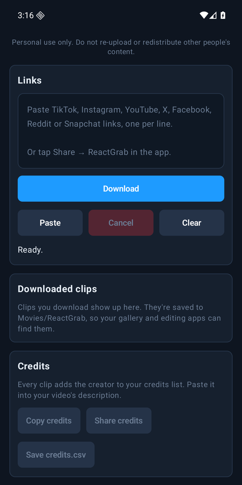

# ReactGrab for Android

**Grab the clip. Credit the creator.** A free Android app from [AC3 Labs](https://ac3labs.com) for reaction and commentary creators.

Share a video to ReactGrab, or paste its link, and get an MP4 saved to your phone, ready for your editing app. ReactGrab also keeps a list of who made each clip, ready to paste into your video's description.

### [Download ReactGrab for Android from ac3labs.com](https://ac3labs.com/reactgrab-android.html)

On a PC? See [ReactGrab for Windows](https://github.com/AC3Labs/ReactGrab).

ReactGrab is free to use but it is not open source. This page is here to point you to the download; the source code is not published.

## What it does

- Works with links from TikTok, Instagram, YouTube, X, Facebook, Reddit and Snapchat.
- Tap **Share → ReactGrab** in another app, or paste one link or a list, one per line.
- Saves every clip as MP4 with H.264 video and AAC audio in Movies/ReactGrab, so your gallery and editing apps can find it.
- Adds every creator to a credits list you can copy, share or save as `credits.csv`.
- Downloads keep going in the background, with a notification, and failures are explained in plain English.

## Installing

Download the APK from [ac3labs.com/reactgrab-android.html](https://ac3labs.com/reactgrab-android.html) on your phone. It needs Android 10 or newer.

ReactGrab isn't on Google Play. Open the downloaded file and allow your browser to install apps when Android asks. Every version is signed with the same AC3 Labs key, so newer versions install over older ones and keep your clips and settings. ReactGrab tells you when a new version is out.

## Keeping it working

Video sites change often, and ReactGrab's downloader has to keep up. It checks for a new one once a day, and you can press **Update Downloader** any time. If downloads still fail, see [Downloads failing?](https://ac3labs.com/reactgrab-android.html#troubleshooting).

## Use it fairly

ReactGrab is for reviewing a clip before you make something original about it: a reaction, a review or a breakdown. The first time it starts it shows its [terms](TERMS.md), and you agree before anything downloads. In short: personal use, public videos only, no re-uploading other people's videos, and keep the credit with the creator.

ReactGrab is not affiliated with, endorsed by or sponsored by TikTok, Instagram, Meta, YouTube, Google, X, Reddit, Snapchat or any creator. All trademarks belong to their owners.

## Licence

ReactGrab is © AC3 Labs. You may download and use it free of charge; see [LICENSE](LICENSE). It includes open-source components under their own licences; see [THIRD-PARTY.md](THIRD-PARTY.md).
